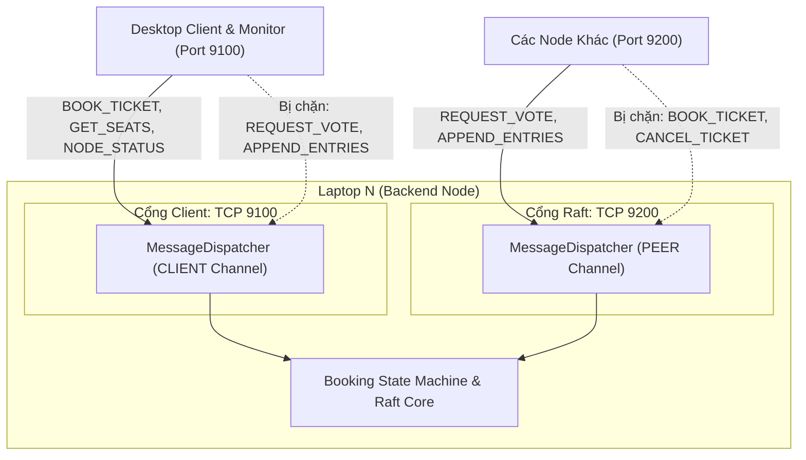

# BẢNG ĐẶC TẢ CỔNG MẠNG VÀ ÁNH XẠ LAN (LAN PORTS & NETWORK TOPOLOGY)

> **Dự án:** Railway Distributed System — Nhóm 6  
> **Tài liệu tham chiếu:** `docs/specs/00-MASTER.md`, `docs/specs/08-DEPLOYMENT.md` (§1, §2, §3, §3.1, §6), `07-TESTING.md` (TC-TCP-04)  
> **Người biên soạn:** TV3 (Networking & Protocol)  
> **Người tiếp nhận & hoàn thiện IP thật:** TV6 (Deployment & Scripting — Task TV6-D24)  
> **Phiên bản:** 1.0 (D23 Baseline với IP Placeholder)

---

## 1. Tổng quan kiến trúc mạng LAN 6 Laptop

Hệ thống vé tàu phân tán Nhóm 6 triển khai trên mạng cục bộ (LAN vật lý) bao gồm **6 Laptop** độc lập:
- **5 Laptop (Laptop 1 đến 5):** Chạy Backend Node (`node-1` .. `node-5`) và 1 instance PostgreSQL riêng biệt cho từng Node. Đóng vai trò là **5 Voter** chính thức của cụm đồng thuận Raft (Quorum cố định $3/5$). Mỗi laptop có thể mở kèm JavaFX Desktop Client.
- **1 Laptop (Laptop 6):** Chạy JavaFX Desktop Client và JavaFX Cluster Monitor. **Tuyệt đối KHÔNG phải là voter**; tắt Laptop 6 không làm thay đổi quorum hay trạng thái của cụm 5 Node.

> [!IMPORTANT]
> **Quy tắc an toàn IP (AGENTS.md §0 & §5):**  
> Các địa chỉ IP trong tài liệu này và các file cấu hình `node-1..5.properties` là **IP PLACEHOLDER** (mẫu `192.168.10.11`..`15` theo SPEC-08 và `192.168.1.101`..`105` theo `client.properties`).  
> **KHÔNG** commit IP thật của các máy cá nhân lên Git repository. TV6-D24 sẽ lập danh bạ IP thực địa khi ráp mạng LAN tại phòng thực hành.

---

## 2. Bảng ma trận ánh xạ 6 Laptop (Topology & Port Matrix)

| Laptop | Thành phần chạy | Node ID | Vai trò Raft | IP Placeholder mẫu | Cổng Client (TCP) | Cổng Raft Peer (TCP) | PostgreSQL riêng (TV2) |
|---|---|---|---|---|---|---|---|
| **Laptop 1** | Backend Node 1 + PostgreSQL 1 (+ Desktop Client) | `node-1` | **Voter** (1/5) | `192.168.10.11` | `9100` | `9200` | `localhost:5433` (`railway_node1`) |
| **Laptop 2** | Backend Node 2 + PostgreSQL 2 (+ Desktop Client) | `node-2` | **Voter** (2/5) | `192.168.10.12` | `9100` | `9200` | `localhost:5434` (`railway_node2`) |
| **Laptop 3** | Backend Node 3 + PostgreSQL 3 (+ Desktop Client) | `node-3` | **Voter** (3/5) | `192.168.10.13` | `9100` | `9200` | `localhost:5435` (`railway_node3`) |
| **Laptop 4** | Backend Node 4 + PostgreSQL 4 (+ Desktop Client) | `node-4` | **Voter** (4/5) | `192.168.10.14` | `9100` | `9200` | `localhost:5436` (`railway_node4`) |
| **Laptop 5** | Backend Node 5 + PostgreSQL 5 (+ Desktop Client) | `node-5` | **Voter** (5/5) | `192.168.10.15` | `9100` | `9200` | `localhost:5437` (`railway_node5`) |
| **Laptop 6** | JavaFX Desktop Client + Cluster Monitor | *N/A* | **Non-voter** | `192.168.10.16` | *Không mở* | *Không mở* | *Không truy cập DB* |

*Ghi chú về cổng PostgreSQL:* Khi chạy multi-node trên cùng 1 máy (chế độ dev / `compose.dev.yml`), các cổng PostgreSQL host là `5433..5437` để tránh xung đột với cổng `5432` mặc định của Windows. Khi deploy 1 container/node trên mỗi Laptop riêng biệt, cổng nội bộ container là `5432` và có thể publish ra host `5432` hoặc giữ `5433..5437` theo config tương ứng.

---

## 3. Quy tắc phân tách kênh & cổng (Channel / Port Isolation)

Theo **SPEC-08 §3.1** (dòng 64) và **SPEC-07 TC-TCP-04**, hệ thống bắt buộc phân tách hoàn toàn kênh giao tiếp của Client và kênh giao tiếp giữa các Peer Raft thông qua `MessageDispatcher`:



### 3.1. Cổng Client TCP `9100` (`ChannelType.CLIENT`)
- **Mục đích:** Nhận yêu cầu từ người dùng (JavaFX Desktop Client) và công cụ giám sát (JavaFX Desktop Monitor).
- **Các loại bản tin ĐƯỢC PHÉP:**
  - `GET_SEATS`
  - `BOOK_TICKET`
  - `CANCEL_TICKET`
  - `GET_REQUEST_RESULT`
  - `NODE_STATUS`
- **Các loại bản tin BỊ TỪ CHỐI TRIỆT ĐỂ:**
  - `REQUEST_VOTE`
  - `APPEND_ENTRIES`
- **Hành vi xử lý:** Nếu nhận được bản tin Raft RPC trên cổng 9100, `MessageDispatcher` lập tức từ chối và phản hồi `ERROR_RESPONSE` với mã `INVALID_REQUEST`, thông điệp: `"Raft RPC messages are not allowed on client channel: <type>"`.

### 3.2. Cổng Raft Peer TCP `9200` (`ChannelType.PEER`)
- **Mục đích:** Nhận các RPC đồng thuận giữa 5 Node trong cụm Raft (Node-to-Node).
- **Các loại bản tin ĐƯỢC PHÉP:**
  - `REQUEST_VOTE`
  - `APPEND_ENTRIES`
- **Các loại bản tin BỊ TỪ CHỐI TRIỆT ĐỂ:**
  - `BOOK_TICKET`, `CANCEL_TICKET`, `GET_SEATS`, `GET_REQUEST_RESULT`, v.v.
- **Hành vi xử lý:** Nếu nhận được bản tin nghiệp vụ client trên cổng 9200, `MessageDispatcher` lập tức từ chối và phản hồi `ERROR_RESPONSE` với mã `INVALID_REQUEST`, thông điệp: `"Non-Raft messages are not allowed on peer channel: <type>"`.

---

## 4. Định dạng cấu hình danh bạ `NODE_PEERS` (SPEC-08 §3 & ElectionRuntime)

Toàn bộ 5 Node trong cụm phải được cấu hình chuỗi danh bạ `NODE_PEERS` giống hệt nhau.  
Định dạng bắt buộc được quy định và kiểm tra bởi hàm `ElectionRuntime.parsePeers()`:

```text
node-1@<IP_LAPTOP_1>:9200,node-2@<IP_LAPTOP_2>:9200,node-3@<IP_LAPTOP_3>:9200,node-4@<IP_LAPTOP_4>:9200,node-5@<IP_LAPTOP_5>:9200
```

### Chuỗi mẫu với IP Placeholder:
```dotenv
NODE_PEERS=node-1@192.168.10.11:9200,node-2@192.168.10.12:9200,node-3@192.168.10.13:9200,node-4@192.168.10.14:9200,node-5@192.168.10.15:9200
```

### Yêu cầu cú pháp của `ElectionRuntime.parsePeers()`:
1. Mỗi phần tử có định dạng `<node-id>@<host>:<port>`.
2. Định danh phải là `node-[1-5]`.
3. Cổng port phải nằm trong khoảng hợp lệ $[1, 65535]$.
4. Danh sách phải chứa đầy đủ và chính xác 5 voter: `Set.of("node-1", "node-2", "node-3", "node-4", "node-5")`.
5. Không được có ID trùng lặp.
6. Quorum tính toán luôn là $\lfloor 5/2 \rfloor + 1 = 3$.

---

## 5. So sánh cấu hình Môi trường Dev vs Môi trường LAN

| Đặc điểm | Môi trường Dev (1 Laptop / Docker) | Môi trường LAN (6 Laptop vật lý) |
|---|---|---|
| **Vị trí chạy 5 Node** | 5 container trên cùng 1 máy | 1 Node trên Laptop 1..5 |
| **Client Port** | Published ra Windows host: `9101..9105` | Cố định `9100` trên mỗi Laptop |
| **Peer Raft Port** | Nội bộ container: `node-N:9200` qua docker bridge | Cố định `9200` trên mỗi Laptop qua IP LAN |
| **Địa chỉ Client kết nối** | `127.0.0.1:9101` .. `127.0.0.1:9105` | `<IP_LAPTOP_1..5>:9100` |
| **Địa chỉ Peer kết nối** | `node-1:9200` .. `node-5:9200` | `<IP_LAPTOP_1..5>:9200` |
| **File cấu hình Client** | `cluster.profile=dev` | `cluster.profile=lan` |
| **Tài liệu tham chiếu** | `configs/dev/cluster.properties` | `configs/lan/PORTS.md` & `node-1..5.properties` |

---

## 6. Hướng dẫn cấu hình Tường lửa (Firewall Checklist)

Để đảm bảo các gói tin TCP Socket không bị hệ điều hành chặn trong mạng LAN, các Laptop cần mở cổng:

### Trên Laptop 1 đến 5 (Chạy Backend):
Mở cổng nhận kết nối Inbound TCP cho cổng `9100` (Client) và `9200` (Peer):
```powershell
# Chạy trên PowerShell với quyền Administrator (Windows):
New-NetFirewallRule -DisplayName "Railway-Client-TCP-9100" -Direction Inbound -LocalPort 9100 -Protocol TCP -Action Allow
New-NetFirewallRule -DisplayName "Railway-Raft-Peer-TCP-9200" -Direction Inbound -LocalPort 9200 -Protocol TCP -Action Allow
```
*(Trên Linux: `sudo ufw allow 9100/tcp && sudo ufw allow 9200/tcp`)*

### Trên Laptop 6 (Client / Monitor):
Không cần mở cổng Inbound cho Backend, chỉ cần đảm bảo mạng không chặn kết nối Outbound tới các cổng `9100` của Laptop 1–5.

---

## 7. Quy trình Bàn giao cho TV6-D24 (Live IP Inventory & Deployment Runbook)

1. **Bước 1 (TV6-D24):** Khi các thành viên tập trung tại phòng máy/LAN chung, TV6 lấy địa chỉ IP vật lý của từng Laptop bằng lệnh `ipconfig` (Windows) hoặc `ip a` (Linux).
2. **Bước 2 (TV6-D24):** Điền bảng IP thực tế vào tài liệu triển khai cục bộ (hoặc file `.env` trên từng Laptop), ví dụ:
   - Laptop 1: `192.168.1.51`
   - Laptop 2: `192.168.1.52`
   - Laptop 3: `192.168.1.53`
   - Laptop 4: `192.168.1.54`
   - Laptop 5: `192.168.1.55`
   - Laptop 6: `192.168.1.56`
3. **Bước 3 (TV6-D24/D25):** Cập nhật chuỗi `NODE_PEERS` tương ứng trên cả 5 Laptop trước khi khởi động Node.
4. **Bước 4 (TV6-D25):** Kiểm tra ping và telnet/nc thử cổng 9100/9200 giữa các Laptop để xác nhận thông mạng trước khi khởi động consensus.
